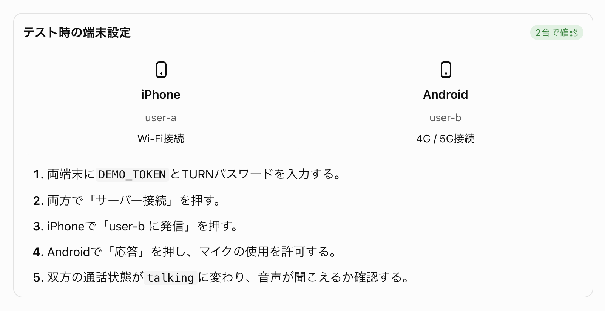

# 通話テスト

## 1. テスト手順

Flutterアプリのコードでは、user-aが発信するとuser-bに着信し、応答するとWebRTC接続が始まります。逆方向の発信にも対応します。

- ユーザーIDの指定  
テストに使用する2端末間で コード内で user-a / user-b を指定してます。 実機に転送する前に .env 内の USER_ID で 2端末で user-a / user-b を切り替えて設定してください。


## 2. Wi-Fi設定
２つの端末の両方を同じWi-Fiに接続しないようにして実行。



同じWi-Fi内にある端末同士でも、必ず自宅のTURNサーバーを経由して通信する設定にしています。
自宅ルーターがNATループバック（ヘアピンNAT）に対応していない場合、TURNの中継アドレスにアクセスできず、ICE接続が成立しないことがあります。

## 3. 成功時のログ
正常にWebRTC接続が成立すると、おおむね次のログが表示されます。

```
Socket.IO接続成功
マイク取得成功
Offer送信
Answer受信
ICE状態: RTCIceConnectionStateConnected
相手の音声トラックを受信
```
