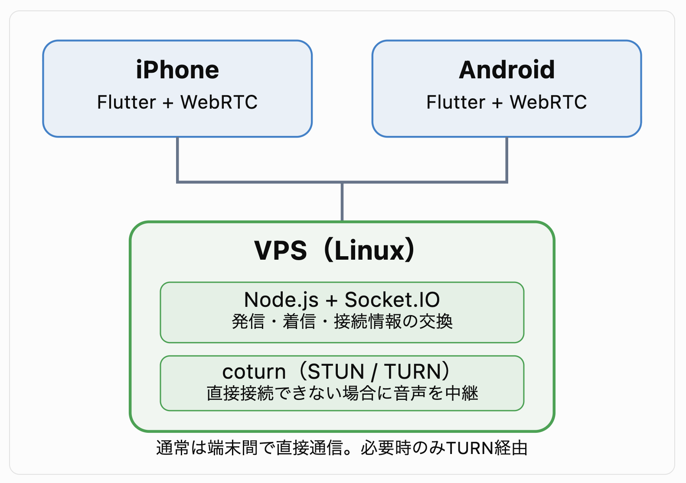

# オープンソースのみで通話アプリを構築

| 機能 | オープンソースの候補 |
|---|---|
|Flutter通話アプリ	|flutter_webrtc|
|音声・映像通信	|WebRTC|
|通話開始・接続制御	|Node.js + WebSocket|
|NAT越え・中継	|coturn（STUN/TURN）|

## 1. 無料構成
|機能	|採用技術	|費用|
|---|---|---|
|iOS / Androidアプリ	|Flutter	|無料|
|音声・映像通話	|flutter_webrtc	|無料|
|通話相手との接続制御	|Node.js + WebSocket	|無料|
|接続先の交換	|Socket.IO	|無料|
|NAT越え	|公開STUNサーバー	|無料|
|通話用サーバー	|開発用Macで起動	|無料|

## 2. 通話の仕組み

## 3. デモに実装する機能
スマホ2台でのデモ
- ユーザーA・Bの選択
- 相手への発信
- 着信画面と応答・拒否
- 音声通話・マイクのミュート
- 通話終了

## 4. 今回の実装内容

### 1. 自宅サーバー（AlmaLinux）で構築するシステム

|構成	|技術	|役割|
|---|---|---|
|スマートフォン	|Flutter + flutter_webrtc	|音声通話・通話画面|
|通話制御サーバー	|Node.js + Socket.IO	|発信・着信・応答・切断|
|STUN/TURNサーバー	|coturn	|NAT越え・音声中継|
|OS	|AlmaLinux	|自宅サーバー|
|通信暗号化	|Let's Encrypt	|HTTPS / WSS用証明書|

### 2. 通話の流れ

1. Flutterアプリを起動し、Node.jsサーバーに接続。
2. ユーザーAがユーザーBに発信。
3. Socket.IO経由でBに着信通知。
4. Bが応答するとWebRTCの接続処理を開始。
5. 音声通話を行い、終了時に接続を切断。

相手が別のWi-Fiや携帯電話回線を使っていても、通話できる構成にできます。
ただし、インターネット経由の場合は、自宅ルーターのポート転送やファイアウォール設定が必要になります。

### 3. 自宅サーバーで注意すること
- グローバルIPv4アドレス：自宅回線がCGNATや一部のIPv4 over IPv6方式の場合、通常のポート転送ができない可能性があります。
- ポート開放：Node.js用のHTTPS/WSS（443/TCP）、coturn用の3478/UDP・TCP、TURN中継用UDPポート範囲などを設定します。
- coturnの外部IP設定：ルーターの内側に設置する場合、公開IPとサーバーのLAN側IPの対応設定が必要です。
