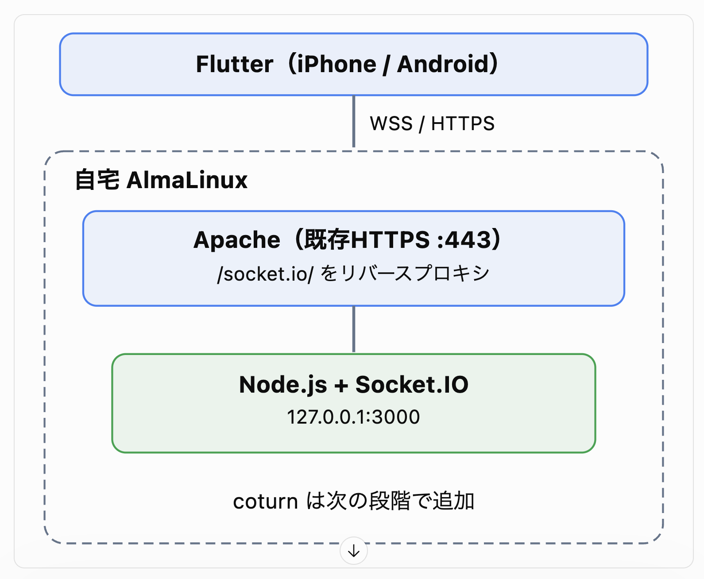

# サーバー構築

- AlmaLinux + Apache（HTTPS）+ Node.js + Socket.IO


## 1. 今回のシステム構成
|項目	|採用技術|
|---|---|
|スマートフォン	|Flutter（iOS / Android）|
|音声通信	|flutter_webrtc|
|通話制御	|Node.js + Socket.IO|
|STUN/TURN	|coturn|
|サーバー	|AlmaLinux|
|ドメイン	|既存のDDNS|
|HTTPS	|既存のTLS証明書|


## 2. AlmaLinux側の構成

```
自宅 AlmaLinux
│
├── 既存Webサーバー（HTTPS :443）
│     │
│     └── /socket.io/
│            └── Node.js :3000
│                 ├── 発信通知
│                 ├── 着信通知
│                 ├── 応答・拒否
│                 └── WebRTC接続情報の交換
│
└── coturn
      ├── STUN/TURN :3478
      ├── TURN over TLS :5349（必要に応じて）
      └── 音声中継用UDPポート
```


## 3. 開発順序
- **STEP 1：WebSocketサーバー**  
AlmaLinuxにNode.jsとSocket.IOを導入し、2台の端末間で発信・着信イベントを交換できるようにします。


- **STEP 2：coturnサーバー**  
coturnを導入し、STUN/TURNの接続確認を行います。自宅ルーター配下では外部IPの設定とポート転送も必要です。

- **STEP 3：Flutterアプリ**  
flutter_webrtcを利用して、発信・着信・応答・終了の画面を作ります。

- **STEP 4：実機での音声通話テスト**  
iPhoneとAndroidをWi-Fi・モバイル回線に分け、TURN経由で音声通話が成立することを検証します。


## Apache（HTTPS）+ Node.js + Socket.IO 設定

### 1. サーバー構成


### 2. Socket.IOプロジェクトを作成
- /opt/flutter-call-server に配置

```
sudo mkdir -p /opt/flutter-call-server
sudo chown "$USER":"$(id -gn)" /opt/flutter-call-server

cd /opt/flutter-call-server

npm init -y
npm install socket.io

```

### 3. 通話制御用のSocket.IOサーバーを実装
- /opt/flutter-call-server/server.jsを作成  
このサンプルでは、ユーザーIDを user-a と user-b の2つに限定し、発信・着信・応答・拒否・通話終了に加え、WebRTCで必要になる接続情報も転送できるようにします。

```

const http = require("node:http");
const { Server } = require("socket.io");

const server = http.createServer();

const io = new Server(server, {
  transports: ["websocket", "polling"],
  maxHttpBufferSize: 100000,
});

const users = new Map();
const allowedUsers = new Set(["user-a", "user-b"]);

io.use((socket, next) => {
  const { userId, token } = socket.handshake.auth;

  if (
    !allowedUsers.has(userId) ||
    !process.env.DEMO_TOKEN ||
    token !== process.env.DEMO_TOKEN
  ) {
    return next(new Error("Unauthorized"));
  }

  next();
});

io.on("connection", (socket) => {
  const userId = socket.handshake.auth.userId;

  // 同じユーザーIDの重複接続は拒否
  if (users.has(userId)) {
    socket.emit("server:error", "Already connected");
    socket.disconnect(true);
    return;
  }

  users.set(userId, socket.id);
  console.log("Connected:", userId);

  socket.emit("server:ready", { userId });

  const events = [
    "call:invite",
    "call:accept",
    "call:reject",
    "call:offer",
    "call:answer",
    "call:ice",
    "call:hangup",
  ];

  for (const event of events) {
    socket.on(event, (data) => {
      if (!data || typeof data !== "object") return;

      const { to, ...payload } = data;

      if (!allowedUsers.has(to) || to === userId) return;

      const targetSocketId = users.get(to);

      if (!targetSocketId) {
        socket.emit("call:unavailable", { to });
        return;
      }

      io.to(targetSocketId).emit(event, {
        from: userId,
        ...payload,
      });
    });
  }

  socket.on("disconnect", () => {
    if (users.get(userId) === socket.id) {
      users.delete(userId);
    }

    const peer = userId === "user-a" ? "user-b" : "user-a";
    const targetSocketId = users.get(peer);

    if (targetSocketId) {
      io.to(targetSocketId).emit("call:hangup", {
        from: userId,
        reason: "disconnected",
      });
    }

    console.log("Disconnected:", userId);
  });
});

server.listen(3000, "127.0.0.1", () => {
  console.log("Socket.IO listening on 127.0.0.1:3000");
});
```

### 4. トークンの作成と疎通確認
DEMO_TOKENを記憶しておくこと。

```
cd /opt/flutter-call-server

export DEMO_TOKEN="$(openssl rand -hex 32)"
echo "$DEMO_TOKEN"

node server.js
```

- 別ターミナルから確認

```
curl -i "http://127.0.0.1:3000/socket.io/?EIO=4&transport=polling"
```

正常ならHTTP 200と、Socket.IOの接続情報が返ります。

### 5. ApacheからSocket.IOへ転送する
- 既存の <VirtualHost *:443> 内に追加する設定

```
ProxyRequests Off
ProxyPreserveHost On
ProxyTimeout 60

RewriteEngine On

RewriteCond %{HTTP:Upgrade} websocket [NC]
RewriteCond %{HTTP:Connection} upgrade [NC]
RewriteRule ^/socket\.io/(.*)$ ws://127.0.0.1:3000/socket.io/$1 [P,L]

ProxyPass /socket.io/ http://127.0.0.1:3000/socket.io/
ProxyPassReverse /socket.io/ http://127.0.0.1:3000/socket.io/
```

反映
```
sudo apachectl configtest
sudo systemctl reload httpd
```

### 6. HTTPS経由で動作確認

```
curl -i "https://your-domain.example/socket.io/?EIO=4&transport=polling"
```

Flutter → HTTPS/WSS → Apache → Node.js の経路が完成


### 7. Node.jsをsystemdで常駐化する

SSHを切断してもSocket.IOが動き続けるように設定します。
専用の実行ユーザーとトークン保存先を作ります。

```
sudo useradd --system --no-create-home  --shell /sbin/nologin callserver

sudo chown -R callserver:callserver /opt/flutter-call-server
sudo mkdir -p /etc/flutter-call-server
```

作成したトークンを /etc/flutter-call-server/server.env に保存します。

```
sudo vi /etc/flutter-call-server/server.env
```

書き込む内容
```
DEMO_TOKEN=ここに生成したトークン
```

権限の設定

```
sudo chown root:root /etc/flutter-call-server/server.env
sudo chmod 600 /etc/flutter-call-server/server.env
```

サービスの作成

```
sudo vi /etc/systemd/system/flutter-call.service
```

書き込む内容

```
[Unit]
Description=Flutter Call Socket.IO Server
After=network.target

[Service]
Type=simple
User=root
Group=root
WorkingDirectory=/opt/flutter-call-server

EnvironmentFile=/etc/flutter-call-server/server.env

ExecStart=/usr/bin/node /opt/flutter-call-server/server.js

Restart=always
RestartSec=3
NoNewPrivileges=true

[Install]
WantedBy=multi-user.target
```

反映
```
sudo systemctl daemon-reload
sudo systemctl enable --now flutter-call
```

確認
```
sudo systemctl status flutter-call
```

ログ確認
```
sudo journalctl -u flutter-call -f
```
